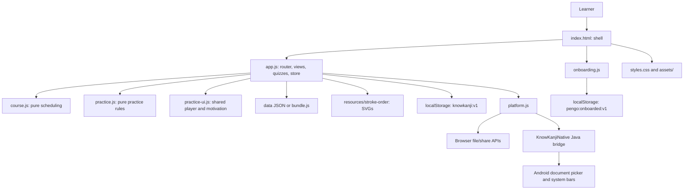
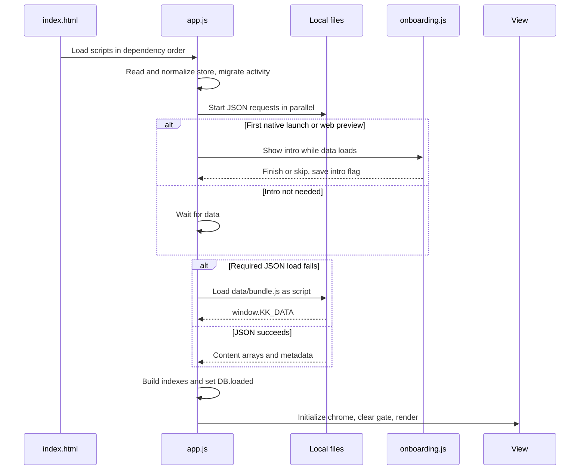
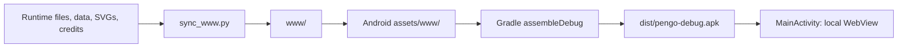

# Architecture

Pengo is a static single-page application with classic scripts and hash navigation. It has no framework, bundler, backend, or remote persistence. A Java Android activity loads the same files from application assets.

## Runtime components

`app.js` owns data indexes, mutable progress, routing, and views. `course.js` computes plan behavior without DOM/storage access. `practice.js` computes selection, SRS scheduling, session validation, and motivation statistics; `practice-ui.js` owns the shared player and daily practice views. Platform adapts native/browser operations, although `app.js` also calls the native bridge directly for backups. Onboarding owns its overlay and completion flag.

| Component | Responsibility | Dependencies |
| --- | --- | --- |
| `index.html` | Shell DOM, metadata, early intro gate, script order | CSS, assets, six scripts |
| `app.js` | Loading/indexing, routes, rendering, persistence, quiz/SRS integration | DOM, Course, Platform, onboarding, local files |
| `course.js` | Dates, pace, order, batches, sampling, streaks, milestones | Built-ins and state callbacks |
| `practice.js` | Pure practice selection, grading, validation, goals, badges | Course and built-ins |
| `practice-ui.js` | Shared quiz/recall player, session summaries, daily dashboard | App globals, Practice, Course |
| `platform.js` | Detection, export, import callback, theme, Back | Browser APIs, optional native globals |
| `onboarding.js` | Intro slides, touch navigation, first-launch decision | DOM, Platform, localStorage |
| `styles.css` | Themes, shell, feature styles, responsive/motion rules | Shell and renderer classes |
| `MainActivity.java` | WebView, bridge, document results, Back/lifecycle | Android framework, packaged files |
| Python scripts | Content transformation, web/APK staging | Filesystem and optional build tools |

## Startup

Script order is `platform.js` → `onboarding.js` → `course.js` → `practice.js` → `practice-ui.js` → `app.js`. These are classic scripts, not ES modules. Top-level `const`/`let` such as `DB` and `store` are global lexical bindings, not necessarily properties on `window`. Course uses `var`; Platform and APP_VERSION are explicitly exported on `window`.

Data and intro run concurrently. Rendering waits for both. The failure handler clears the visibility gate and shows the data-load error. Kanji level files and `meta.json` are required by the fetch path; radicals/vocabulary/grammar catch individual failures, so absent optional data may not trigger bundle fallback.

## State and rendering

Content lives in `DB.levels`, `DB.vocab`, and `DB.grammar`, with `byChar`, `vById`, and `gById` indexes. The mutable `store` holds learned state, favorites, notes, SRS, settings, plan configuration, activity, and practice session/history/achievements. Content itself is excluded from backups.

Handlers mutate the store and call `save()`, which serializes the whole object into `knowkanji:v1`. There is no transaction log, cross-tab coordination, or server acknowledgement; storage errors show a persistent export-backup notice. The saved practice session is validated against loaded content before use, and answered questions resume as feedback without regrading. Curriculum is derived on demand, so changed data/pace may change numbered batches.

`parseHash()` decodes route segments/query pairs. `render()` selects a view, updates navigation, focuses `#view`, and scrolls to the top. Most renderers replace `innerHTML` then bind handlers. Browse search changes only results and replaces history state to preserve focus. Hash routing requires no server route rewriting.

## Native packaging

The bridge is installed as `window.KnowKanjiNative` before loading `file:///android_asset/www/index.html`. Export opens `ACTION_CREATE_DOCUMENT`; import opens `ACTION_OPEN_DOCUMENT`, reads UTF-8, quotes the text with `JSONObject.quote`, then invokes `Platform.receiveImport`.

Android Back evaluates `KKBack()`: intro gets first opportunity, then Platform navigates browser history off Home. Java falls back to activity Back when JavaScript returns false. Activity recreation saves/restores WebView state; localStorage remains the durable progress store.

## Boundaries and constraints

Native assets work offline and the manifest has no internet permission. Hosted web visits still depend on the host for uncached files; the manifest alone supplies no caching. Build-time downloads are separate from runtime access.

Kanji indexes keep the last encountered record across overlapping levels while progress is shared by character. Vocabulary/grammar ID changes can strand stored state. Raw content HTML and SVG cross a trust boundary. Platform origins differ, so backup export/import is the implemented transfer mechanism.

Optional Capacitor declarations are scaffolding, not the implementation of the checked-in Java activity. See [deployment](deployment.md) and [decision records](decisions.md) for related tradeoffs.
