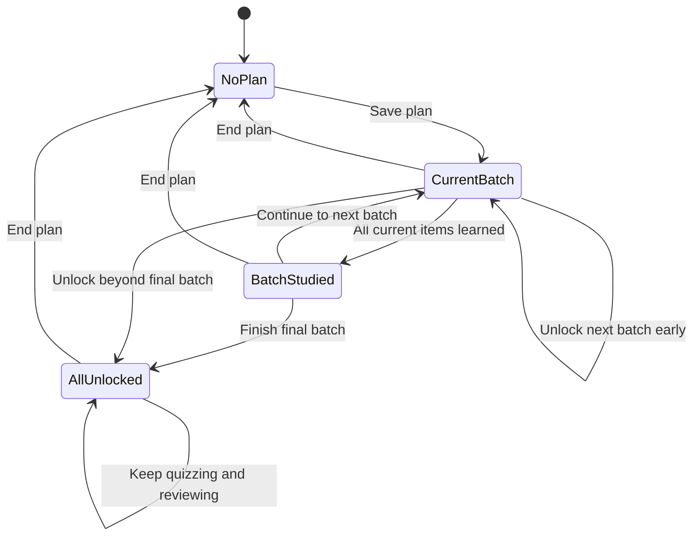

# Study-plan design

The plan references existing kanji/vocabulary/grammar IDs. It shares learned and SRS maps with the reference app and stores only configuration/history under `store.course` in `knowkanji:v1`. `course.js` is pure logic; `app.js` owns views, persistence, and grading integration.

## Responsibilities and entry points

| Area | Pure logic | App integration |
| --- | --- | --- |
| Content ordering | `sortKanji`, `sortVocab`, `sortGrammar` | `courseLists`, frequency map/median helpers |
| Pace and batches | `suggestPace`, `splitDaily`, `buildCurriculum` | Setup, `courseCurriculum` |
| Unlocking/schedule | `unlockedForDay`, `scheduleStatus` | `courseUnlockDay`, `courseSchedule`, day view |
| Sampling | `classifyItem`, `selectQuizItems` | `courseStateOf`, `courseBuildQuestion`, plan quiz |
| Study history/progress | `recordStudyDay`, `calcStreak`, progress helpers | `courseRecordDay`, dashboard |
| Milestones | `checkMilestones`, threshold helpers | `courseCheckMilestones` |

The complete public signatures are in [interfaces](interfaces.md); persisted fields are in [data model](data-model.md).

## Curriculum

A plan targets exactly one level's three lists, not an automatically cumulative N5-to-target curriculum. Already learned records remain in the curriculum and render studied. Lists are ordered before batching:

- Kanji: ascending positive KANJIDIC frequency; absent/nonpositive ranks last.
- Vocabulary: average known finite rank of characters in its kanji surface (or word); unranked/kana-only words use the level median. Ties prefer shorter words, then original order.
- Grammar: Core Grammar, Common, JLPT-Focused, Literary; unknown categories last, stable ties.

`splitDaily` applies a largest-remainder integer split using default weights 3:5:2 (kanji:vocab:grammar). At pace 20 the normal split is 6/10/4. When pace permits at least three items, a share can be borrowed from the largest allocation to give a zero-share type one item.

`buildCurriculum` walks the supplied ID arrays in that order and fills per-type day quotas. Exhausted types leave smaller later batches; unused quota is not redistributed to fill every day to the maximum. A zero-share type can advance once no other type remains. Every supplied entry is emitted once for the shipped/default settings; the function does not independently deduplicate arbitrary input IDs. It has an iteration guard of 100,000 days.

## Pace recommendation

`suggestPace` uses actual per-type counts. It searches upward from total/days until each allocated type fits the horizon. No date, zero, or negative days uses 90 days. It returns recommended/relaxed/intensive choices; recommended is clamped to 5–60, intensive to 5–100, and the UI ultimately clamps the chosen value to 5–100.

Those caps mean a very close exam can still be impossible to meet at the returned recommended pace. The suggestion is guidance, not a guarantee. Setup computes against the full target list, rather than subtracting already learned items. Default course pace is 20, while the setup wizard initially selects the computed recommendation.

## Progress-based unlocking



`unlockedDay` starts at one. All prior/current buckets form the unlocked pool. A missed calendar day never automatically advances the batch. Users explicitly continue after finishing or unlock early, retaining earlier unlearned items as backlog.

`curriculum.length + 1` means every batch is unlocked. This is different from every item learned: the completion view says “You unlocked everything,” while the completed-course milestone requires learned completion.

Day view shows current items, up to 20 earlier unlearned rows, up to 30 due review links, and the daily quiz. Due links are references into details; there is no due-only grading player. The quiz is available while current items are still unlearned.

Schedule status compares remaining curriculum days, including the current batch, against calendar days until the target. It reports done/no-date/passed/on-track/behind; it does not block study. `dayIndex` remains a calendar helper in Course but does not drive current unlocking.

## Plan changes

Setup always reconstructs a plan object when saved. The same target retains start date, unlock position, history, milestones, quiz count, and perfect-quiz flag. A changed target resets start date, `unlockedDay`, and milestones while retaining study days, quiz count/perfect flag, and weights. Learned/SRS maps are untouched.

Changing pace on the same target rebuilds the derived curriculum while retaining its numeric unlock day; the membership of unlocked batches can change. Ending the plan requires confirmation, removes only `store.course`, and returns Home to the level picker. Full data erasure is a separate Settings action.

## Daily quiz selection

`classifyItem` applies these rules in order:

| State | Condition | Sampling weight |
| --- | --- | ---: |
| new | Not learned and not in SRS | 5 |
| weak | In SRS and box zero or due | 4 |
| mastered | Learned and box at least three, after due/weak check | 0.5 |
| learning | Remaining cases | 2 |

The sampler includes up to three randomly chosen `new` items when available, then samples by weight without replacement until the requested count (normally ten) or pool size. “New” is based on learned/SRS state, not necessarily the newest day's bucket.

`Practice.select` adds bounded 3/5/10-question sessions, due/mistake modes, oldest-due priority, and coverage of each available skill for mixed smart/plan sessions. The question builder resolves selected IDs and skips records that are missing or lack distractors. Therefore a quiz can contain fewer than ten questions. Question items are unlocked; distractors can be any other same-type record at the target level. Kanji offers meaning/character/reading questions, vocabulary offers meaning/word questions, and grammar also supports sentence translation/fill-in-the-blank. Choices exclude repeated labels and obvious ambiguous distractors. Recall cards require no distractors.

## Shared SRS grading

Three equivalent graders in `app.js` delegate scheduling to `Practice.nextReview`:

```text
Practice STEPS = [1, 3, 7, 16, 35, 80, 180] days
```

| Action | State effect |
| --- | --- |
| Mark learned/studied for first time | Learned timestamp; initialize missing SRS as box 1 due in one day |
| Correct practice answer | Once per local day, increment box up to index 6; due after `STEPS[newBox]`; mark learned if needed |
| Wrong practice answer | Reset box 0; due after ten minutes; existing learned flag stays |
| Remove learned flag | Remove timestamp only; SRS remains |
| Same-day successful retry | Preserve box/due; cannot repeatedly advance mastery or postpone review |

Because correct answers increment before indexing, a new SRS item at box zero first schedules three days, not one. Manually marked items begin at box one with a one-day initial due time. Preserve this distinction when testing/documenting changes.

All practice answers and first detail-page learning actions record plan study days when a plan exists. Completing a plan-mode quiz increments `quizzes`, sets `perfectQuiz` if appropriate, and checks milestones. Answers and cursor persist on interruption; only completion increments the quiz counter. See [daily learning improvements](learning-improvements.md) for practice goals, week activity, and achievements.

## Streaks, activity, milestones

Study-day lists deduplicate/sort local `YYYY-MM-DD` strings. A streak counts backward from today if studied, otherwise yesterday; yesterday's chain stays visible before studying today. Skipping a day breaks continuity once outside that grace window. This is distinct from visible-time/first-learned statistics in `store.study`.

Nine milestone IDs are `first-session`, `streak-7`, `streak-30`, `vocab-100`, `kanji-50`, `quiz-perfect`, `course-25`, `course-50`, `course-done`. Earned IDs persist; thresholds use plan study days, streak, target-level learned counts, perfect quiz, and full-course percentage. Milestone checks occur at integration points, not on every arbitrary store mutation.

## Exam date generation

`EXAM_MONTHS` uses zero-based July/December months and `firstSunday`. Upcoming choices are generated over a bounded three-year search and filtered on/after today. There is no confirmed-session service or venue calendar. No-date and passed dates remain valid planning states without blocking study.

Date functions use local midnight and fixed 24-hour arithmetic with rounded differences. The existing tests use explicit dates, but daylight-saving/timezone travel behavior deserves separate checks if date semantics change.

## Validation

[Testing](testing.md) describes the existing 97 course assertions and the manual integration checks. Practice unit checks and an optional browser suite additionally exercise selection, SRS, and persistence integration. Native device behavior is still a separate check. [Maintenance](maintenance.md) records the remaining implementation gaps.
