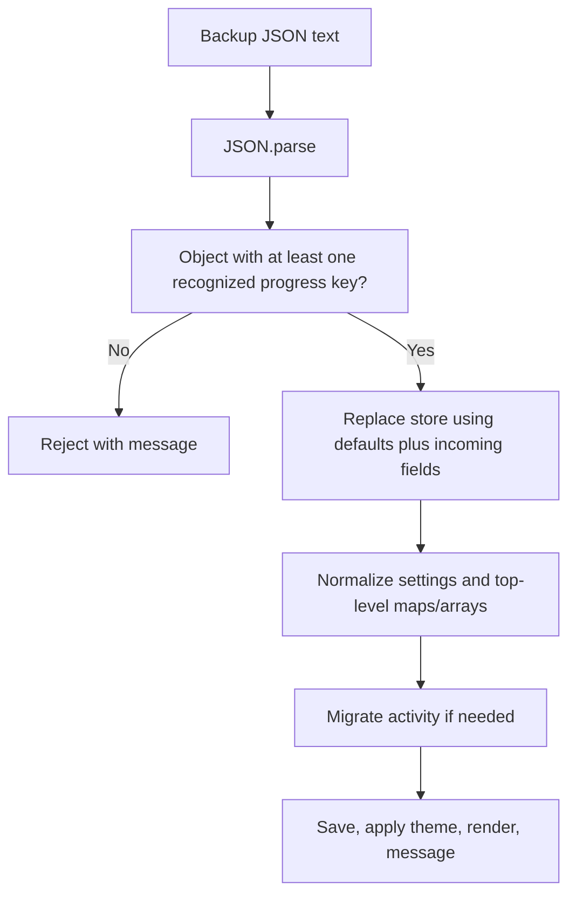

# Data model and persistence

## Identity and indexes

| Content | Stored identity | In-memory lookup |
| --- | --- | --- |
| Kanji | Character, e.g. `一` | `DB.byChar[k] = { item, level }` |
| Vocabulary | Level/JMdict sequence/occurrence, e.g. `N5-1198180-0` | `DB.vById[id] = record` |
| Grammar | Level/ordinal, e.g. `N5-001` | `DB.gById[id] = record` |
| Course item | `{ type: "kanji" | "vocab" | "grammar", id }` | Resolved through those indexes |

Kanji lists overlap: this snapshot has 2,616 rows and 2,211 distinct characters. `byChar` is assigned in N5→N1 order, so later levels overwrite earlier records. Learned/favorite/note/SRS state is character-wide; per-level totals count rows in that level.

Vocabulary IDs depend on level, sequence, and occurrence order within a sequence. Grammar IDs depend on source-note order after same-level duplicate grouping. Neither is guaranteed stable under arbitrary source reordering/insertion. Preserve or migrate IDs when refreshing sources; otherwise existing backups may reference different or missing records.

## Kanji record: `data/n5.json` through `n1.json`

Each file is a UTF-8 JSON array.

| Field | Shape | Meaning |
| --- | --- | --- |
| `k` | string | Single kanji character |
| `meaning` | string | Primary English display meaning |
| `meanings` | string[] | Up to five CSV variants |
| `on`, `kun` | string[] | Readings; generator caps at six/eight |
| `strokes`, `grade`, `freq` | number or null | Metadata; lower positive frequency is more common |
| `jlpt` | `"N5"` … `"N1"` | This row's level |
| `components` | Component[] | Structural/mnemonic parts |
| `vocab` | `{ w, r, m }[]` | Up to six embedded compounds; not full vocab records |
| `sentences` | Sentence[] | Up to four examples |
| `confusables` | string[] | Up to eight look-alike characters |
| `hasStroke` | boolean | SVG existed when data was built |
| `cp` | string | Lowercase codepoint, padded to at least five hex digits |
| `mnemonic` | string | Curated CSV memory aid or deterministic template |

Component fields are `c` (display character), `m` (meaning), `rad` (Kangxi number or null), `isKanji` (boolean), `link` (dataset character or null), and `variantOf` (standard form or null). A part is not necessarily a canonical radical; mnemonic descriptions are not etymology.

Kanji sentences contain `jp`, `en`, `ro`, and optionally `furi`. `ro` is a legacy display field populated from source `kana` or an empty string; do not assume it is always romanization. `furi` is HTML using `<ruby>base<rt>reading</rt></ruby>` and may be partial or absent.

## Vocabulary record: `data/vocab_n*.json`

| Field | Shape | Meaning |
| --- | --- | --- |
| `id` | string | Level-qualified identifier |
| `seq` | string | JMdict sequence from CSV; may be empty |
| `word` | string | Kanji surface if present, otherwise kana |
| `reading` | string | Kana reading |
| `kanji` | string | Original kanji-form column; empty for kana-only |
| `meaning` | string | First normalized gloss |
| `meanings` | string[] | Up to six distinct split glosses |
| `jlpt` | string | Level |
| `sentences` | `{ jp, en, furi? }[]` | Up to three matched examples, possibly empty |

Example identifiers are actual data shapes; missing examples are allowed and not filled with invented sentences. Furigana can come from the dictionary annotator and optional Sudachi supplementation.

## Grammar record: `data/grammar_n*.json`

| Field | Shape | Meaning |
| --- | --- | --- |
| `id` | string | Level/three-digit ordinal |
| `point`, `jlpt`, `frequency`, `meaning` | strings | Display point, level, frequency category, meaning |
| `sections` | `{ label, html }[]` | Explanation sections; generator allows `b`, `i`, `br` markup |
| `examples` | `{ jp, furi, en }[]` | Aligned source examples; can contain emphasis markup |
| `related` | string[] | Point names matched in related explanations, not IDs |
| `sourceNotes` | number[] | Zero-based processed source-note positions |

Frequency ranking recognizes `Core Grammar`, `Common`, `JLPT-Focused`, and `Literary`. Other values sort after those; this snapshot includes a combined `Literary/JLPT-Focused` value treated as unknown by that ranker.

## Metadata and fallback bundle

| File | Shape |
| --- | --- |
| `radicals.json` | 214 records `{ n, char, meaning, reading }`, canonical Kangxi order |
| `meta.json` | `{ levels: { N5: { count, stroke }, ... }, total, strokeCoverage }` |
| `vocab_meta.json` | `{ levels: { N5: { count, withSentences, withKanji }, ... }, total, withSentences, sentencePairs }` |
| `grammar_meta.json` | `{ levels: { N5: { count, withExamples, examples }, ... }, total, withExamples, examples, frequencies, unclassified, source }` |
| `bundle.js` | Classic script assigning `window.KK_DATA` |

Bundle keys are `levels`, `meta`, `radicals`, `vocab`, `vocab_meta`, `grammar`, and `grammar_meta`. It duplicates the JSON for environments where script loading works but fetch does not. It contains no user data or SVG bytes.

`DB` uses camel-case `vocabMeta`/`grammarMeta` internally and tracks `loaded` and `source` (`fetch` or `bundle`). Runtime indexes are derived and excluded from backups.

## Main local store

`STORE_KEY = "knowkanji:v1"`. Export is the serialized store itself, with no separate envelope/schema-version field.

| Fields | Shape/default | Purpose |
| --- | --- | --- |
| `learned`, `vLearned`, `gLearned` | `{ [id]: timestampMs }`, `{}` | Truthy learned state and initial timestamp |
| `fav`, `vFav`, `gFav` | ID arrays, `[]` | Favorites |
| `notes`, `vNotes`, `gNotes` | `{ [id]: string }`, `{}` | Trimmed notes |
| `srs`, `vSrs`, `gSrs` | `{ [id]: { box, due, lastReviewed?, lastCorrectDay? } }`, `{}` | Review box and epoch-millisecond due time |
| `quizBest`, `vQuizBest`, `gQuizBest` | `{ [level]: number }`, `{}` | Best raw ten-question, single-kind, single-level quiz score |
| `settings` | Object below | Presentation and practice preferences |
| `course` | Plan object or `null` | Active plan |
| `study` | Activity object below | Rolling statistics and one-time learning dedupe |
| `practice` | Session/history/badges/mistakes object | Resumable practice and daily motivation |

Default settings:

```json
{
  "theme": "light",
  "dailyGoal": 5,
  "autoplay": true,
  "hideBanner": false
}
```

Settings exposes theme, autoplay, and `dailyGoal` (3/5/10/20 unique items practiced per local day). The goal is independent of plan new-item pace. `hideBanner` remains a legacy preference.

### Plan object

```json
{
  "target": "N3",
  "examId": "",
  "examLabel": "",
  "examDate": "",
  "startDate": "2026-10-07",
  "dailyNew": 20,
  "unlockedDay": 1,
  "weights": { "kanji": 3, "vocab": 5, "grammar": 2 },
  "studyDays": [],
  "milestones": [],
  "quizzes": 0,
  "perfectQuiz": false
}
```

This is an illustrative default-shaped plan, not a required target/date. `Course.defaultCourse()` computes the local start date. The setup UI assigns `examId` the selected date string; `upcomingExams()` itself returns year-month session IDs. Curriculum and content copies are not stored.

`unlockedDay` is one-based; `curriculum.length + 1` represents all batches unlocked. `studyDays` is a sorted unique local-date list. Milestone IDs come from `Course.MILESTONES`. See [course](course.md) for changes/resets and grading.

### Activity object

```json
{
  "days": { "2026-10-07": { "seconds": 15, "learned": 1 } },
  "loggedLearned": { "kanji:一": true },
  "migratedLearned": true
}
```

`loggedLearned` counts an item's first recorded learning once over the store's lifetime, even if its learned flag is later removed and restored. Startup migration credits existing learned timestamps to local dates and sets `migratedLearned`. Visible elapsed time flushes every 15 seconds, on visibility changes, and on pagehide; each flush is capped at 30 seconds. It measures visible app time, not verified active study.

The labels “This Week” and “This Month” represent rolling seven/thirty local-date windows, not calendar week/month boundaries. The daily dashboard streak uses actual practiced/learned items in `study.days`; passive visible time does not count. Course milestone streaks still use `course.studyDays`, now updated by all practice answers and first learning actions.

Daily entries also contain `attempts`, `correct`, and `practiced: { ["type:id"]: true }`. Wrong answers count as attempts and unique practice. Learned and reviewed instances of the same item count once that day. Migration reconstructs known item keys from old learned timestamps; any remaining legacy learned count is preserved as `legacyLearned`.

### Practice object

`practice` defaults to `{ session: null, history: [], badges: [], mistakes: {} }` and is included in exports. Old backups get empty practice state. Nested practice containers receive normalization; invalid saved sessions or removed question/option IDs are discarded before rendering.

A version-1 session stores an ID, normalized configuration (`mode`, `kind`, `lv`, `size`, `format`), up to ten question references (`type`, `id`, `lv`, `variant`, `options` as IDs), `cursor`, `answers` (`ok`, `selected`), `startedAt`, and `startingBadges`. Content is resolved from DB; answers are saved before feedback. The cursor can point at an already answered question so its explanation can resume without a second grade.

Completion clears the active session and appends an ID-deduplicated summary to the latest 60 history entries (`id`, `date`, `score`, `total`, `format`, `mode`, `lv`). Recall scores are self-ratings. Badges contain IDs from `Practice.BADGES`. Mistakes are keyed by `type:id`, with `{ type, id, misses, lastMissed }`; correct answers clear that entry. Session replacement preserves previously recorded activity and SRS.

## Separate onboarding state

`pengo:onboarded:v1` stores the string `"1"` after finishing/skipping the intro. It is not included in the main backup. Erase resets the main store and removes this flag. Imported progress does not by itself suppress a new platform's intro.

## Device reminder preferences

`pengo:reminders:v1` stores browser `{ enabled, time, lastDate }`, normalized to off/`19:00`/empty by default. `time` must be `HH:MM`; `lastDate` is the last local date with a daily alert. Android's private SharedPreferences `pengo_reminders` instead stores `enabled`, `time`, `lastDate`, `goalDate`, `nextAt`, and `permissionAsked`. The native bridge is authoritative on Android; browser preferences do not schedule native alarms.

Reminder preferences are outside `knowkanji:v1` and its progress exports. Import preserves this device's opt-in/time and updates native goal suppression from imported practice. Confirmed erase resets device reminder preferences and cancels native scheduling, without changing OS permission or removing imported external calendar events. Android's existing platform backup policy still applies. See [design and reminders](design-and-reminders.md).

## Backup and migration semantics



Import replaces rather than merges existing progress and has no preview/confirmation. It requires a non-array object with at least one of the learned/favorite/note/SRS keys. Top-level progress maps/arrays and activity containers receive basic normalization; nested SRS values, course fields, dates, IDs, and timestamps are not comprehensively validated. Unknown top-level properties survive `Object.assign`.

Startup loading also merges defaults but normalizes settings less thoroughly than import. Invalid JSON starts from defaults; syntactically valid malformed structures may still cause runtime errors. Failed main-store writes display a backup notice; an import success message is not proof of durable persistence.

Backup files are plaintext JSON with notes/progress; native uses a document picker and web uses sharing/download/file input. They carry no content dataset version. Preserve compatible IDs and test old backups before storage changes. See [security](security.md) and [testing](testing.md).
