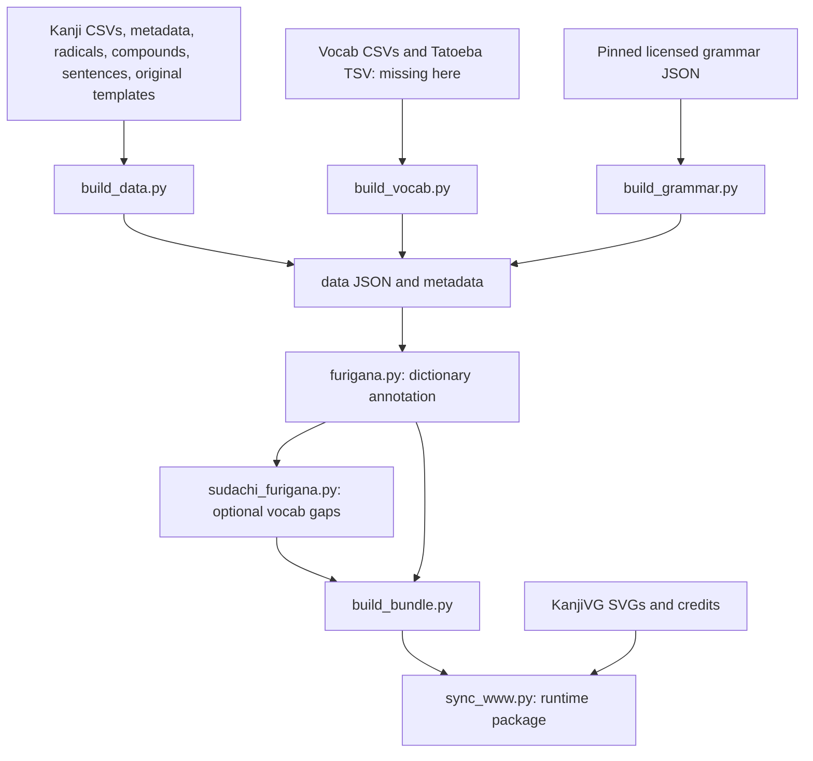

# Content pipeline

Runtime uses prebuilt `data/` and KanjiVG SVGs; it does not parse CSVs, corpora, or Anki packages. Generators run on a development/build machine.

## Input availability

Checked on 2026-10-16:

| Input | Used by | Available in this checkout? |
| --- | --- | --- |
| `resources/kanji/kanji_n{1-5}.csv` | Kanji builder | Yes |
| `resources/kanji/kanji_metadata.json` | Kanji metadata/components | Yes |
| `resources/radicals/radicals_metadata.csv`, `kradfile` | Kanji components/radicals | Yes |
| `resources/compounds/jlpt-compounds-n{1-5}.json` | Embedded kanji compounds | Yes |
| `resources/sentences/jed-kanji-sentences.json` | Kanji examples | Yes |
| Pengo templates in `scripts/build_data.py` | Original memory aids | Yes |
| `resources/stroke-order/kanjivg/*.svg` | Coverage and runtime art | Yes; 2,383 SVGs |
| `resources/vocab/n{1-5}.csv` | Vocabulary builder | **No** |
| `resources/vocab/sentence_tatoeba/jp-eng-sentence-pairs.tsv` | Vocabulary examples | **No** |
| `resources/grammar/japanese-language-data/n*.json` | Grammar builder | Yes; pinned CC BY-SA 4.0 source |
| Existing `data/` JSON and `bundle.js` | Runtime, furigana dictionary, packaging | Yes |

The missing raw vocabulary inputs do not prevent running or packaging the prebuilt app. They do prevent full vocabulary regeneration. The repository does not provide a downloader or exact pinned source artifact for those inputs; obtain the correct files and provenance before rebuilding. Do not use empty substitutes.

`resources/` is tracked as ordinary files here. There is no root `.gitmodules` despite comments/upstream docs referring to a submodule.

## Build graph



Kanji/vocab builders opportunistically use the furigana lookup from existing generated data. This is a bootstrap dependency: annotation can differ when old generated files are absent. Run the standalone annotation pass after generating all content to refresh the shared lookup.

## Script inventory

| Script | Input/action | Output and side effects |
| --- | --- | --- |
| `build_data.py` | Merge kanji CSV/metadata and supporting resource files | Overwrites `n*.json`, `radicals.json`, `meta.json` |
| `build_vocab.py` | Normalize vocab CSV; match corpus sentences | Overwrites `vocab_n*.json`, `vocab_meta.json`; requires missing inputs |
| `build_grammar.py` | Verify pinned licensed JSON; convert and annotate | Overwrites `grammar_n*.json`, `grammar_meta.json`; no network or missing deck |
| `furigana.py` | Dictionary from existing vocab, embedded compounds, grammar ruby | Rewrites kanji/vocab sentences and grammar example furigana; `--check` reports without writing |
| `sudachi_furigana.py` | Tokenizer supplements uncovered vocabulary readings | Rewrites only vocab JSON; `--check` simulates/report only |
| `build_bundle.py` | Read generated JSON | Overwrites `data/bundle.js`; top-level script executes on import |
| `build_strokes.py` | Read bundled KanjiVG SVGs unchanged | Writes lazy `data/strokes/*.js` chunks with original notices; rerun after SVG updates; also invoked by staging |
| `sync_kanji_data.py` | Fetch upstream metadata and compare | Default reports only; `--write` replaces vendored metadata |
| `sync_www.py` | Copy runtime inventory | Stage `www/` or directory supplied through `--out` |
| `build_apk.py` | Stage runtime, copy native assets, invoke Gradle | Debug APK; `--assets-only` skips Gradle |
| `build_apk_docker.py` | Build image and extract APK | Docker image/container operations, `dist/pengo-debug.apk` |

## Rebuild procedure

From the repository root, with all required inputs available:

```sh
python3 scripts/build_data.py
python3 scripts/build_vocab.py
python3 scripts/build_grammar.py
python3 scripts/furigana.py
# Optional, only with the tokenizer installed:
python3 scripts/sudachi_furigana.py
python3 scripts/build_bundle.py
```

Omit the optional Sudachi line when its dependencies are not installed. For a kanji-only change in this checkout, rebuild kanji and the fallback bundle; leave unavailable vocab/grammar builders alone. If running a broader annotation pass, review all affected JSON, since it can touch grammar too.

Inspect `git diff --stat` and generated differences before committing. Compare IDs and metadata counts, validate stroke paths and cross-links, and check real Japanese examples. Rebuild `bundle.js` **after** the last JSON edit. Stage runtime assets only after the data is final.

### Optional Sudachi

The recorded versions in `resources/CREDITS.md` for the existing refresh are:

```sh
python3 -m venv /tmp/pengo-data-venv
/tmp/pengo-data-venv/bin/python -m pip install sudachipy==0.6.11 sudachidict_core==20260723
/tmp/pengo-data-venv/bin/python scripts/sudachi_furigana.py --check
/tmp/pengo-data-venv/bin/python scripts/sudachi_furigana.py
python3 scripts/build_bundle.py
```

These pins document the recorded data refresh, not a newly verified package-availability guarantee. The tokenizer/dictionary is not shipped at runtime. It preserves mapped existing ruby and supplements uncovered kanji using token readings; linguistic review is still needed.

## Transformation rules

### Kanji

The CSV defines level membership and preferred display text; metadata supplies strokes, grade, frequency, and fallback readings. KRADFILE is read as EUC-JP. Compounds are indexed by source character across levels and capped at six; sentence examples combine a CSV example and corpus examples, capped at four. Mnemonic CSV text has HTML stripped, then template generation supplies a fallback. Kangxi numbering uses a canonical 214-character sequence rather than source-file-local numbering. `hasStroke` reflects SVG existence at build time.

### Vocabulary

Rows become IDs `{level}-{sequence-or-x}-{occurrence}`. Meaning strings split into at most six unique glosses. Sentence matching uses an Aho–Corasick substring scan: a CJK kanji surface is preferred; kana-only words need at least three characters. Japanese/English length limits are 90/170 characters. The builder gathers at most eight candidates per entry and selects up to three short candidates; they are not necessarily the shortest in the entire corpus. Matching is lexical, not semantic. Unmatched records keep `sentences: []`.

### Grammar

Grammar is rebuilt from the pinned Japanese Language Data `grammar-curated` snapshot (CC BY-SA 4.0, Justin Kindrix and contributors). Source SHA-256 hashes are checked before conversion. The builder escapes HTML, adds dictionary-based furigana and converts related links. It preserves 141 matched old IDs; new notes use stable source-derived IDs. There are 595 notes and 1,787 examples. Upstream labels these notes as community drafts. Unmatched retired progress remains in exports rather than being assigned to unrelated material.

### Dictionary furigana

The annotator builds a surface→reading lookup from generated vocabulary, embedded compounds, and grammar ruby, resolves conflicts using observed reading frequency, adds stem variants, and scans longest matches. Unknown runs can remain plain text. Dictionary matches are not contextual disambiguation, so complete/accurate readings are not guaranteed. `--check` reports ruby coverage, not linguistic correctness; its sentence summary concerns kanji/vocab while grammar is handled separately.

## Runtime loading contract

`loadDataFetch()` requests 19 files in parallel. Five kanji arrays plus `meta.json` are required; radicals and each vocabulary/grammar request individually catch errors to empty data/null metadata. A required fetch/parse failure causes `loadData()` to load `bundle.js` as a classic script. Successful loading builds indexes and sets `DB.source`/`DB.loaded`. Stroke diagrams load separately: fetch/XHR first over HTTP/native schemes, then lazy `data/strokes/*.js` classic-script fallback; `file://` uses the fallback directly. Each fallback chunk spans at most 256 code points and preserves the source SVG strings verbatim. Run `python3 scripts/build_strokes.py` after SVG updates for direct source-folder use; staging runs it automatically.

Optional-file failures may leave empty sections while reporting source `fetch`; the bundle is not consulted to fill each missing optional file. Fetch JSON calls do not first check HTTP status. A parseable but wrong-shaped response can fail later during indexing. Package completeness matters even when startup succeeds.

## Provenance and attribution

Keep [resource credits](../resources/CREDITS.md) with packaged content. They cover KANJIDIC2/KRADFILE and related EDRDG data, KanjiVG, Tanaka, Kanjium, JLPT vocab/Tatoeba, tokenizer-derived readings, and the pinned licensed grammar source. The former unlicensed mnemonic CSV, grammar-deck text and WaniKani fields have been removed from the release. See `docs/fdroid.md` for historical-source publication status.

Do not rewrite upstream `resources/README.md` as if it only described Pengo: it also describes other consumers. Record app-specific transformations here. Before source refresh, preserve IDs/provenance and review compatibility with existing progress.
